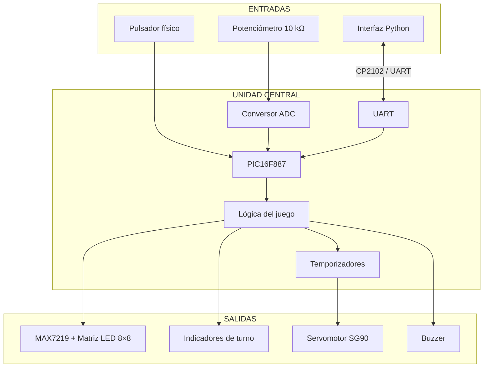

# 4 en Línea

**Trabajo Práctico Final · Electrónica Digital II**  
Facultad de Ciencias Exactas, Físicas y Naturales · Universidad Nacional de Córdoba · Ingeniería Electrónica e Ingeniería Biomédica

**Grupo 09**

Integrantes:


**Docente:** Marcos Blasco

---

## Índice

1. [Descripción del proyecto](#1-descripción-del-proyecto)
2. [Alcance del proyecto](#2-alcance-del-proyecto)
3. [Arquitectura del sistema](#3-arquitectura-del-sistema)
4. [Arquitectura de software](#4-arquitectura-de-software)
5. [Especificaciones eléctricas, alimentación y entorno](#5-especificaciones-eléctricas-alimentación-y-entorno)
6. [Proceso de integración y desarrollo](#6-proceso-de-integración-y-desarrollo)
7. [Ensayos, pruebas y resultados](#7-ensayos-pruebas-y-resultados)
8. [Etapas siguientes y trabajo futuro](#8-etapas-siguientes-y-trabajo-futuro)
9. [Estructura del repositorio](#9-estructura-del-repositorio)

---

## 1. Descripción del proyecto

**4 en Línea** es un juego electrónico para dos jugadores basado en un microcontrolador **PIC16F887**. El tablero lógico de 6 filas × 7 columnas se muestra en una **matriz LED de 8×8** controlada por un **MAX7219**, y toda la lógica del juego (reglas, turnos, caída de fichas, detección de victoria y empate) se ejecuta en el PIC, programado en lenguaje ensamblador.

Las jugadas pueden ingresarse de dos maneras:

- **Control físico:** un potenciómetro selecciona la columna y un pulsador confirma la jugada.
- **Control por computadora:** una interfaz gráfica en Python, conectada al PIC por UART, permite mover la selección a izquierda y derecha y confirmar la jugada.

Las fichas del jugador 1 permanecen encendidas y las del jugador 2 parpadean. Dos LED indican de quién es el turno. Cuando alguien gana, un **servomotor SG90** mueve una bandera hacia el lado del ganador y un **buzzer** suena durante aproximadamente 2 segundos. Finalizada la señalización la bandera vuelve a su posición central de 90°

El PIC es la única autoridad del sistema: la computadora solo envía comandos y recibe estados, pero nunca decide dónde cae una ficha ni evalúa victorias.

## 2. Alcance del proyecto

**El sistema es capaz de:**

- **Ejecutar una partida completa** entre dos jugadores, con alternancia de turnos y caída de fichas por gravedad.
- **Detectar el final de la partida:** cuatro fichas alineadas horizontal, vertical o diagonalmente, o empate por tablero lleno.
- **Aceptar jugadas desde dos fuentes:** potenciómetro más pulsador, o interfaz Python por UART. El método activo es el de la última entrada que produjo un cambio efectivo en la selección.
- **Visualizar el tablero** en una matriz LED de 8×8 con el MAX7219 (SPI), diferenciando a los jugadores por ficha fija y ficha parpadeante.
- **Indicar el turno** mediante dos LED.
- **Señalizar al ganador** con la bandera del servomotor (0° o 180°) y el buzzer. El buzzer suena durante aproximadamente 2 segundos y luego la bandera vuelve a 90°.
- **Comunicarse con la PC** por UART: recibe comandos (`L`, `R`, `D`) y envía información sobre el turno, la validez de las jugadas y el resultado.

**El sistema NO es capaz de:**

- **Jugar contra la máquina:** no hay inteligencia artificial, solo dos jugadores humanos.
- **Reiniciar la partida por software:** una vez finalizada, queda bloqueado hasta un reinicio por **MCLR**.
- **Guardar partidas ni estadísticas:** no hay memoria no volátil de resultados.

## 3. Arquitectura del sistema

### 3.1. Diagrama de bloques



### 3.2. Hardware e interconexión

El **PIC16F887** (DIP-40) es la unidad de control y se conecta con los demás bloques de la siguiente manera:

- **Potenciómetro (RA0/AN0):** entrada analógica para elegir la columna.
- **Pulsador (RB0/INT):** confirma la jugada mediante interrupción externa, con antirrebote.
- **MAX7219 (RC3/SCK, RC5/SDO, RD3/CS):** controla la matriz LED 8×8 por SPI.
- **UART (RC6/TX, RC7/RX):** enlace con la PC a través del adaptador USB-UART CP2102.
- **LED de turno (RD0 y RD1):** indican si juega el jugador 1 o el jugador 2.
- **Buzzer (RD2):** señal sonora al detectarse un ganador.
- **Servomotor SG90 (RC2):** señal de control de la bandera.
- **Cristal de 4 MHz (OSC1/OSC2)** con capacitores de 22 pF a GND, y **reset** por MCLR.

| Pin físico | Señal | Función |
|---:|---|---|
| 1 | MCLR | Reinicio del sistema |
| 2 | RA0/AN0 | Entrada del potenciómetro |
| 13 | OSC1 | Cristal de 4 MHz |
| 14 | OSC2 | Cristal de 4 MHz |
| 17 | RC2 | Señal de control del SG90 |
| 18 | RC3/SCK | Reloj SPI hacia el MAX7219 |
| 19 | RD0 | LED jugador 1 |
| 20 | RD1 | LED jugador 2 |
| 21 | RD2 | Buzzer |
| 22 | RD3 | LOAD/CS del MAX7219 |
| 24 | RC5/SDO | Datos hacia DIN del MAX7219 |
| 25 | RC6/TX | UART hacia la PC |
| 26 | RC7/RX | UART desde la PC |
| 33 | RB0/INT | Pulsador físico |

> La distribución corresponde al encapsulado DIP-40 del PIC16F887.

**Esquemático del circuito:** [PENDIENTE: agregar imagen del circuito definitivo de Proteus].

### 3.3. Descripción del circuito y consideraciones de diseño

#### ADC: potenciómetro a columna

El potenciómetro de 10 kΩ forma un divisor de tensión entre 0 V y 5 V, y su cursor se conecta a AN0.

El ADC utiliza como referencias de conversión VDD y VSS, por lo que, con una alimentación de 5 V, el rango de entrada corresponde aproximadamente a 0–5 V. Se configura el resultado con **justificación izquierda** y se utilizan los 8 bits más significativos almacenados en `ADRESH`, obteniendo un valor entre 0 y 255.

Para obtener las 7 columnas del tablero:

```text
columna = ADRESH / 37
```

| Columna | 0 | 1 | 2 | 3 | 4 | 5 | 6 |
|---|---|---|---|---|---|---|---|
| ADRESH | 0–36 | 37–73 | 74–110 | 111–147 | 148–184 | 185–221 | 222–255 |

Para evitar que la selección oscile en los límites entre columnas se puede agregar histéresis o promediar muestras.

#### Timer0: parpadeo y base de tiempo general

Timer0 se utiliza para generar el parpadeo de las fichas del jugador 2 y como base de tiempo para otras tareas temporizadas del sistema.

Con $F_{osc}=4\text{ MHz}$, el ciclo de instrucción es:

$$
T_{inst}=\frac{4}{F_{osc}}=1\ \mu s
$$

Con prescaler 1:256 y sin precarga, Timer0 desborda cada:

$$
T=256\times256\times1\ \mu s=65,536\text{ ms}
$$

Se utiliza como base de tiempo mediante contadores por software:

| Tarea | Desbordes | Tiempo resultante |
|---|---:|---:|
| Parpadeo del jugador 2 (alternar estado) | 8 | ≈ 524 ms |
| Activación del buzzer | 31 | ≈ 2,03 s |
| Antirrebote del pulsador | 1 | ≈ 65,5 ms |

Esto supone un desbordamiento de Timer0 cada 65,536 ms.

#### Timer1: señal del servomotor SG90

El servo requiere una señal de aproximadamente **50 Hz**, equivalente a un período de 20 ms. El ancho del pulso en alto determina la posición angular:

| Ángulo | Ancho de pulso |
|---:|---:|
| 0° | 1 ms |
| 90° | 1,5 ms |
| 180° | 2 ms |

Con prescaler 1:1, el temporizador tiene una resolución de 1 µs. La precarga se calcula mediante:

$$
TMR1=65536-\frac{T}{T_{inst}}
$$

| Fase | Duración | Precarga (decimal) | TMR1H:TMR1L |
|---|---:|---:|---|
| Pulso a 0° | 1 ms | 64536 | 0xFC18 |
| Pulso a 90° | 1,5 ms | 64036 | 0xFA24 |
| Pulso a 180° | 2 ms | 63536 | 0xF830 |

La fase en bajo completa el período de 20 ms. Por ejemplo, para un pulso de 1,5 ms:

$$
T_{bajo}=20\text{ ms}-1,5\text{ ms}=18,5\text{ ms}
$$

La precarga correspondiente es:

$$
TMR1=65536-18500=47036=0xB7BC
$$

La interrupción de Timer1 alterna entre la fase alta y la fase baja, recargando el valor correspondiente para mantener el período de la señal.

> Los valores de precarga son teóricos. Durante la implementación se deberá considerar el tiempo de latencia y ejecución de la rutina de interrupción, ya que introduce una diferencia entre el desbordamiento del temporizador y el cambio efectivo de estado de la salida. Los anchos de pulso deberán calibrarse mediante medición. Los valores de 1 a 2 ms son habituales para el SG90, aunque el rango real puede variar entre unidades.

#### UART: velocidad de transmisión

La comunicación asíncrona se configura a **9600 baudios**, con BRGH = 1 y $F_{osc}=4\text{ MHz}$.

El valor de SPBRG se calcula mediante:

$$
SPBRG=\frac{F_{osc}}{16\cdot Baud}-1
$$

$$
SPBRG=\frac{4\times10^6}{16\cdot9600}-1=25,04\approx25
$$

La velocidad real obtenida es:

$$
Baud_{real}=\frac{4\times10^6}{16\cdot(25+1)}
=9615\text{ bps}
$$

El error relativo es:

$$
Error=\frac{9615-9600}{9600}\times100
\approx0,16\%
$$

La configuración utiliza 8 bits de datos, sin paridad y un bit de parada (8N1).

#### SPI con el MAX7219

El módulo MSSP del PIC funciona como maestro SPI con una frecuencia de reloj de:

$$
f_{SPI}=\frac{F_{osc}}{4}=1\text{ MHz}
$$

Cada transmisión envía 16 bits, correspondientes a una dirección de registro y un dato. La señal CS (RD3) se utiliza para delimitar la transmisión.

Los registros de configuración inicial del MAX7219 son:

| Registro | Dirección | Valor inicial |
|---|---:|---|
| Decode mode | 0x09 | 0x00 (sin decodificación) |
| Intensity | 0x0A | [PENDIENTE: definir brillo inicial] |
| Scan limit | 0x0B | 0x07 (8 filas) |
| Shutdown | 0x0C | 0x01 (operación normal) |
| Display test | 0x0F | 0x00 |

#### Representación del tablero

El tablero lógico tiene 6 filas y 7 columnas. Cada posición puede encontrarse vacía u ocupada por una ficha de alguno de los dos jugadores.

La información del tablero se almacena en memoria RAM y se utiliza para determinar la posición de las fichas y actualizar la matriz LED.

En la matriz de 8×8 se utilizan 6 filas y 7 columnas (42 LED). Las dos filas restantes y la columna restante permanecen apagadas.

El parpadeo del jugador 2 se resuelve alternando la información enviada al MAX7219: en una fase se muestran las fichas de ambos jugadores y en la otra solamente las del jugador 1.

#### Alimentación y masas

El PIC y el módulo MAX7219 se alimentan desde una fuente de 5 V, cuya capacidad de corriente debe ser suficiente para ambos bloques.

El servomotor SG90 utiliza una fuente regulada de 5 V independiente, debido a los picos de corriente que se producen durante su movimiento. Las masas del PIC, MAX7219, servo y CP2102 se conectan en común.

**[PENDIENTE: realizar una prueba de funcionamiento del sistema completo, verificando que los movimientos del servomotor no provoquen caídas de tensión ni reinicios del microcontrolador].**

## 4. Arquitectura de software

El firmware está escrito en **lenguaje ensamblador (MPASM)** y sigue una arquitectura manejada por interrupciones, con un lazo principal que lee el ADC y administra el estado del juego.

### 4.1. Lazo principal

El programa principal realiza las siguientes tareas:

1. Convierte el valor del ADC en una columna candidata.
2. Actualiza la columna seleccionada si el potenciómetro produjo un cambio efectivo.
3. Procesa los comandos recibidos por UART, almacenados previamente desde la rutina de interrupción.
4. Si hay una jugada confirmada, la valida, ubica la ficha, evalúa victoria o empate, cambia de turno y actualiza la matriz LED.

### 4.2. Gestión de interrupciones

Como el PIC16F887 dispone de un único vector de interrupción, la rutina de servicio (ISR) consulta las banderas de las distintas fuentes para identificar el evento que debe atender.

| Prioridad | Fuente | Tarea |
|---:|---|---|
| 1 | TMR1IF | Generación del pulso del servomotor |
| 2 | TMR0IF | Parpadeo del jugador 2, antirrebote y temporización del buzzer 2 s |
| 3 | INTF (RB0) | Confirmación de jugada por pulsador |
| 4 | RCIF | Recepción de comandos desde la PC |

La prioridad indicada es el orden de atención previsto dentro de la ISR. La rutina deberá identificar y atender correctamente las banderas pendientes de cada periférico.

### 4.3. Control compartido de la selección

Los controles físico y virtual comparten una única variable que almacena la columna seleccionada.

La selección cambia de método de control cuando una entrada produce un cambio efectivo:

- Si el potenciómetro modifica la columna seleccionada, el control físico pasa a ser el método activo y los comandos de izquierda y derecha enviados desde la PC dejan de modificar la selección.
- Si los comandos de izquierda o derecha enviados desde la PC modifican la columna, el control por computadora pasa a ser el método activo y el potenciómetro deja de modificar la selección.

El método activo se mantiene hasta que el otro control produzca un cambio efectivo en la selección.

Ambos métodos utilizan el mismo proceso de confirmación y validación de jugadas: el pulsador físico mediante RB0/INT y el botón de disparo de la interfaz de Python mediante UART.

### 4.4. Protocolo UART

Los comandos enviados desde la interfaz de Python son caracteres ASCII terminados en salto de línea.

| Comando | Descripción |
|---|---|
| `L` | Mover la selección a la izquierda |
| `R` | Mover la selección a la derecha |
| `D` | Confirmar la jugada |

El PIC responde con información sobre el jugador del turno, la aceptación o el rechazo de una jugada y el resultado de la partida.

**[PENDIENTE: definir el formato exacto de los mensajes de respuesta del PIC y los valores utilizados para representar cada estado].**

La comunicación utiliza 9600 baudios, 8 bits de datos, sin paridad y un bit de parada (8N1).

### 4.5. Interfaz de Python

La aplicación gráfica se desarrolla en Python y utiliza PySerial para la comunicación con el PIC a través del puerto serie.

La interfaz dispone de tres botones:

- **Izquierda:** envía el comando `L`.
- **Derecha:** envía el comando `R`.
- **Disparar:** envía el comando `D`.

También muestra el turno actual y el resultado de la partida. La computadora no representa el tablero ni ejecuta las reglas del juego: únicamente permite ingresar comandos y visualizar la información recibida desde el microcontrolador.

### 4.6. Finalización de la partida

Cuando el PIC detecta una victoria, determina qué jugador ganó y ejecuta la señalización correspondiente:

- El servomotor mueve la bandera hacia la posición del jugador ganador.
- El buzzer se activa durante aproximadamente 2 segundos.
- Finalizado ese tiempo, el buzzer se apaga y la bandera vuelve a la posición central de 90°.
- El juego queda bloqueado y no acepta nuevas jugadas hasta que se realice un reinicio mediante MCLR.

En caso de empate, el PIC informa el resultado a través de la comunicación UART para que sea mostrado en la interfaz de Python. No se realiza una señalización específica mediante el servomotor.

## 5. Especificaciones eléctricas, alimentación y entorno

### 5.1. Parámetros de alimentación y consumo

| Parámetro | Valor |
|---|---|
| Tensión de operación del sistema lógico | 5 V |
| Alimentación PIC + MAX7219 | Fuente de 5 V con corriente suficiente para ambos |
| Alimentación del servo | Fuente regulada de 5 V independiente |
| Referencia de masa | GND común entre todos los bloques |
| Consumo medido | [PENDIENTE   |

El consumo del sistema varía con la cantidad de LED encendidos en la matriz, el brillo configurado en el MAX7219 y el movimiento del servomotor.

### 5.2. Entorno de desarrollo

| Herramienta | Aplicación |
|---|---|
| MPLAB X IDE + MPASM | Desarrollo y ensamblado del firmware |
| Bootloader AN1310 | Carga del programa en el PIC |
| Python + PySerial | Interfaz gráfica y comunicación serie |
| Proteus | Simulación del circuito |
| Git / GitHub | Control de versiones y trabajo colaborativo |

### 5.3. Configuración de bits

La configuración prevista para el microcontrolador contempla los siguientes bits:

| Bit | Configuración prevista | Motivo |
|---|---|---|
| Oscilador `_FOSC_XT` | Cristal externo de 4 MHz | Base de tiempo para UART, SPI y temporizadores |
| `_WDTE_OFF` | Watchdog deshabilitado | Evitar reinicios involuntarios |
| `_MCLRE_ON` | MCLR habilitado | Permitir el reinicio manual del sistema |
| `_BOREN_ON` | Brown-out reset habilitado | Reinicio ante caídas de tensión |
| `_LVP_OFF` | Programación en bajo voltaje deshabilitada | Liberar RB3 y evitar reprogramaciones accidentales |

### 5.4. Periféricos internos utilizados

- **ADC:** canal AN0, justificación izquierda, lectura de `ADRESH`.
- **Timer0:** prescaler 1:256, base de tiempo para parpadeo del jugador 2, antirrebote y temporización del buzzer.
- **Timer1:** prescaler 1:1, generación de la señal del servo.
- **MSSP (SPI maestro):** comunicación con el MAX7219.
- **EUSART:** modo asíncrono a 9600 baudios (SPBRG = 25, BRGH = 1).
- **Interrupción externa INT (RB0):** pulsador de confirmación.

## 6. Proceso de integración y desarrollo

El desarrollo del proyecto se organiza en etapas para facilitar la implementación y la integración progresiva de los distintos bloques del sistema.

### 6.1. Etapas de desarrollo

1. **Validación del hardware base:** oscilador, reset y alimentación del PIC16F887.
2. **Visualización:** inicialización del MAX7219 por SPI y encendido de la matriz LED.
3. **Entradas:** lectura del ADC con el potenciómetro y pulsador con interrupción y antirrebote.
4. **Lógica del juego:** caída de fichas, alternancia de turnos y detección de victoria y empate.
5. **Temporización:** implementación del parpadeo del jugador 2 mediante Timer0.
6. **Comunicación:** UART con comandos y respuestas, e integración de la interfaz de Python.
7. **Actuadores:** control del servomotor mediante Timer1 y activación del buzzer.
8. **Integración y pruebas:** ejecución de partidas completas utilizando ambos métodos de control.

## 7. Ensayos, pruebas y resultados

El plan de pruebas contempla la validación individual de cada subsistema y, finalmente, el funcionamiento integral del juego.

| Subsistema | Prueba | Estado | Evidencia |
|---|---|:---:|---|
| ADC | Selección correcta de las 7 columnas | ☐ | — |
| Pulsador | Confirmación y antirrebote | ☐ | — |
| Selección | Cambio entre control físico y por PC | ☐ | — |
| Lógica del juego | Caída de fichas y alternancia de turnos | ☐ | — |
| Victoria | Alineaciones horizontales, verticales y diagonales | ☐ | — |
| Empate | Tablero completo sin ganador | ☐ | — |
| MAX7219 | Visualización de fichas y parpadeo | ☐ | — |
| UART | Recepción de comandos y envío de estados | ☐ | — |
| Timer0 | Parpadeo del jugador 2 | ☐ | — |
| Timer1 | Señal del servo (medición de 50 Hz y anchos de pulso) | ☐ | — |
| Actuadores | Movimiento de bandera y activación del buzzer | ☐ | — |
| Alimentación | Funcionamiento estable durante el movimiento del servo | ☐ | — |
| Sistema completo | Partida completa de punta a punta | ☐ | — |

**Hardware ensamblado:** [PENDIENTE: agregar fotografía del montaje].

**Simulación en Proteus:** [PENDIENTE: agregar captura de la simulación].

**Resultados de las pruebas:** [PENDIENTE: agregar evidencias, mediciones y comentarios de los ensayos realizados].

La aceptación final exige que las entradas, el procesamiento, la visualización y los actuadores funcionen en conjunto durante una partida completa, incluyendo la detección del resultado y el bloqueo posterior a una victoria.

## 8. Etapas siguientes y trabajo futuro

Como posibles ampliaciones del proyecto se consideran:

- Agregar un **modo contra la máquina** mediante una estrategia de juego sencilla.
- Implementar un **botón de reinicio por software** que no dependa de MCLR.
- Mostrar el **resultado de empate** también en el hardware, por ejemplo, mediante una posición intermedia de la bandera o un patrón específico en la matriz.
- Migrar el circuito de protoboard a una **placa de circuito impreso (PCB)**.
- Incorporar un sistema de **puntaje acumulado** entre partidas.

Estas funcionalidades no forman parte del alcance de la implementación actual.

## 9. Estructura del repositorio

La organización prevista para los archivos del proyecto es la siguiente:

```text
4-en-linea/
├── README.md
├── src/
│   └── Firmware/          # Fuentes del PIC16F887 (.asm)
├── interfaz/              # Código de la interfaz Python
├── sim/                   # Simulaciones de Proteus
├── hardware/
│   ├── Esquematicos/
│   ├── Conexionado/
│   └── Componentes/
├── docs/
│   ├── diagramas/
│   ├── documentacion/
│   └── imagenes/
└── .gitignore
```
