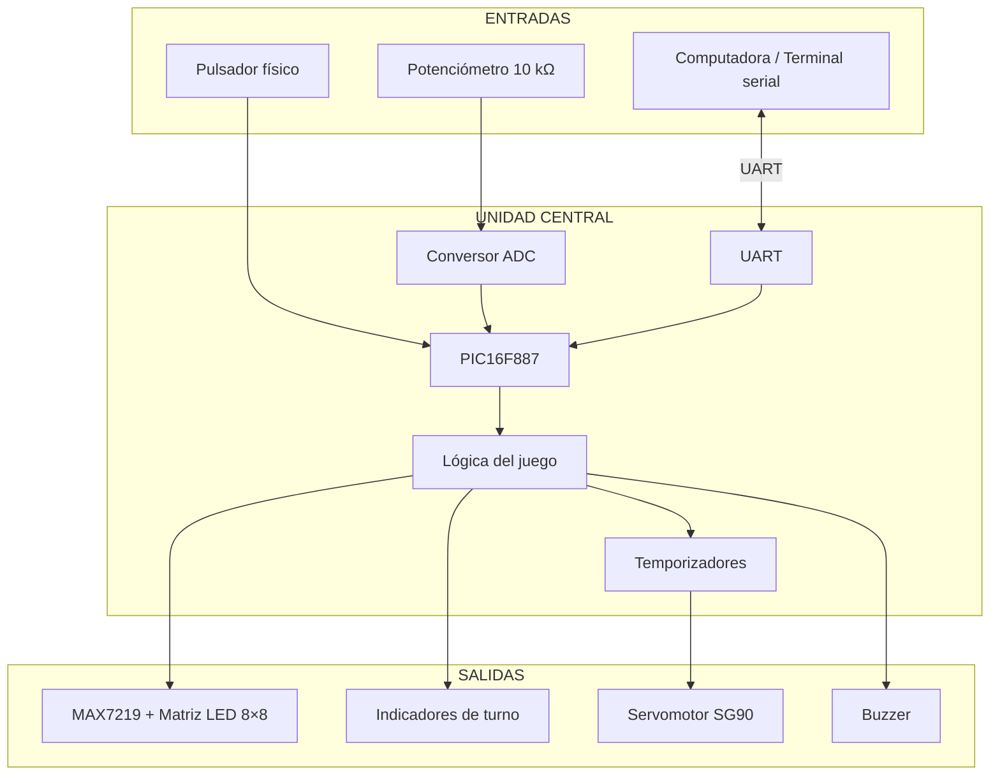

# 4 en Línea

**Trabajo Práctico Final · Electrónica Digital II**  
Facultad de Ciencias Exactas, Físicas y Naturales · Universidad Nacional de Córdoba · Ingeniería Electrónica e Ingeniería Biomédica

**Grupo 09**

Integrantes:

**Docente:** Marcos Blasco

---

## Índice

1. [Descripción del proyecto](#1-descripción-del-proyecto)
2. [Alcance del proyecto](#2-alcance-del-proyecto)
3. [Arquitectura del sistema](#3-arquitectura-del-sistema)
4. [Arquitectura de software](#4-arquitectura-de-software)
5. [Especificaciones eléctricas, alimentación y entorno](#5-especificaciones-eléctricas-alimentación-y-entorno)
6. [Proceso de integración y desarrollo](#6-proceso-de-integración-y-desarrollo)
7. [Ensayos, pruebas y resultados](#7-ensayos-pruebas-y-resultados)
8. [Etapas siguientes y trabajo futuro](#8-etapas-siguientes-y-trabajo-futuro)
9. [Estructura del repositorio](#9-estructura-del-repositorio)

---

## 1. Descripción del proyecto

**4 en Línea** es un juego electrónico para dos jugadores basado en un microcontrolador **PIC16F887**. El tablero se representa en una **matriz LED de 8×8** controlada por un **MAX7219**. Se utilizan 7 filas para el área de juego y 8 columnas. La línea restante de la matriz se reserva para indicar la columna seleccionada mediante un cursor. Toda la lógica del juego (reglas, turnos, caída de fichas, detección de victoria y empate) se ejecuta en el PIC, programado en lenguaje ensamblador.

Las jugadas pueden ingresarse mediante dos métodos de control:

- **Control físico:** un potenciómetro permite seleccionar una de las ocho columnas y un pulsador confirma la jugada.
- **Control mediante computadora:** se utiliza una terminal serial para enviar comandos al PIC a través de la comunicación UART.

Las fichas del jugador 1 permanecen encendidas y las del jugador 2 parpadean. Dos LED indican de quién es el turno. Cuando alguien gana, primero se activa el buzzer durante aproximadamente 2 segundos. Una vez finalizada la señal sonora, el servomotor SG90 mueve la bandera hacia el lado correspondiente al ganador. La bandera permanece en esa posición hasta que se reinicia el sistema mediante el pulsador de MCLR; al reiniciarse, vuelve a la posición central de 90°.

## 2. Alcance del proyecto

**El sistema es capaz de:**

- **Ejecutar una partida completa** entre dos jugadores, con alternancia de turnos y caída de fichas por gravedad.
- **Detectar el final de la partida:** cuatro fichas alineadas horizontal, vertical o diagonalmente, o empate por tablero lleno.
- **Aceptar jugadas mediante controles físicos:** el potenciómetro selecciona una de las ocho columnas y el pulsador confirma la jugada.
- **Aceptar comandos desde una computadora:** mediante una terminal serial conectada por UART se puede mover el cursor y confirmar una jugada.
- **Visualizar el juego** en una matriz LED de 8×8 con el MAX7219 (SPI), utilizando una línea como indicador de la columna seleccionada y las siete filas restantes como área de juego.
- **Indicar el turno** mediante dos LED.
- **Señalizar al ganador** mediante el buzzer y la bandera accionada por el servomotor. Primero suena el buzzer durante aproximadamente 2 segundos y luego la bandera se mueve hacia el lado del ganador, donde permanece hasta el reinicio mediante MCLR.

**Comandos de la terminal serial:**

| Comando | Función |
|---|---|
| `L` | Mover el cursor una columna hacia la izquierda |
| `R` | Mover el cursor una columna hacia la derecha |
| `D` | Confirmar la jugada y soltar la ficha |

Los comandos se envían como caracteres individuales en mayúscula. La selección no puede salir de los límites del tablero: la columna mínima es 0 y la máxima es 7.

**El sistema NO es capaz de:**

- **Jugar contra la máquina:** no hay inteligencia artificial, solo dos jugadores humanos.
- **Reiniciar la partida por software:** una vez finalizada, queda bloqueado hasta un reinicio por **MCLR**.
- **Guardar partidas ni estadísticas:** no hay memoria no volátil de resultados.

## 3. Arquitectura del sistema

### 3.1. Diagrama de bloques



### 3.2. Hardware e interconexión

El **PIC16F887** (DIP-40) es la unidad de control y se conecta con los demás bloques de la siguiente manera:

- **Potenciómetro (RA0/AN0):** entrada analógica para elegir la columna.
- **Pulsador (RB0/INT):** confirma la jugada mediante interrupción externa, con antirrebote.
- **Comunicación UART (RC6/TX y RC7/RX):** permite recibir comandos desde una computadora mediante una terminal serial.
- **MAX7219 (RC3/SCK, RC5/SDO, RD3/CS):** controla la matriz LED 8×8 por SPI.
- **LED de turno (RD0 y RD1):** indican si juega el jugador 1 o el jugador 2.
- **Buzzer (RD2):** señal sonora al detectarse un ganador.
- **Servomotor SG90 (RC2):** señal de control de la bandera.
- **Cristal de 4 MHz (OSC1/OSC2)** con capacitores de 22 pF a GND, y **reset** por MCLR.

| Pin físico | Señal | Función |
|---:|---|---|
| 1 | MCLR | Reinicio del sistema |
| 2 | RA0/AN0 | Entrada del potenciómetro |
| 13 | OSC1 | Cristal de 4 MHz |
| 14 | OSC2 | Cristal de 4 MHz |
| 17 | RC2 | Señal de control del SG90 |
| 18 | RC3/SCK | Reloj SPI hacia el MAX7219 |
| 19 | RD0 | LED jugador 1 |
| 20 | RD1 | LED jugador 2 |
| 21 | RD2 | Buzzer |
| 22 | RD3 | LOAD/CS del MAX7219 |
| 24 | RC5/SDO | Datos hacia DIN del MAX7219 |
| 25 | RC6/TX | Transmisión UART hacia la PC |
| 26 | RC7/RX | Recepción UART desde la PC |
| 33 | RB0/INT | Pulsador físico |

> La distribución corresponde al encapsulado DIP-40 del PIC16F887.

**Conexión de la comunicación serial:** la transmisión de la computadora debe conectarse a RC7/RX del PIC y la recepción de la computadora a RC6/TX. Ambas interfaces deben compartir GND y utilizar niveles lógicos compatibles con el microcontrolador.

**Esquemático del circuito:** [PENDIENTE: agregar imagen del circuito definitivo de Proteus].

### 3.3. Descripción del circuito y consideraciones de diseño

#### ADC: potenciómetro a columna

El potenciómetro de 10 kΩ forma un divisor de tensión entre 0 V y 5 V, y su cursor se conecta a AN0.

El ADC utiliza como referencias de conversión VDD y VSS, por lo que, con una alimentación de 5 V, el rango de entrada corresponde aproximadamente a 0–5 V. Se configura el resultado con **justificación izquierda** y se utilizan los 8 bits más significativos almacenados en `ADRESH`, obteniendo un valor entre 0 y 255.

Para obtener las ocho columnas del tablero, el valor de `ADRESH` se divide por 32:

$$
\text{columna} = 7 - \frac{ADRESH}{32}
$$

La división se realiza mediante desplazamientos sucesivos a la derecha. La resta respecto de 7 invierte el sentido de selección para que el movimiento del potenciómetro coincida con la orientación del cursor.

| Columna | 0 | 1 | 2 | 3 | 4 | 5 | 6 | 7 |
|---|---|---|---|---|---|---|---|---|
| ADRESH | 224–255 | 192–223 | 160–191 | 128–159 | 96–127 | 64–95 | 32–63 | 0–31 |

#### Timer0: parpadeo y base de tiempo general

Timer0 se utiliza para generar el parpadeo de las fichas del jugador 2 y como base de tiempo para otras tareas temporizadas del sistema.

Con $F_{osc}=4\text{ MHz}$, el ciclo de instrucción es:

$$
T_{inst}=\frac{4}{F_{osc}}=1\ \mu s
$$

Con prescaler 1:256 y sin precarga, Timer0 desborda cada:

$$
T=256\times256\times1\ \mu s=65,536\text{ ms}
$$

Se utiliza como base de tiempo mediante contadores por software:

| Tarea | Desbordes | Tiempo resultante |
|---|---:|---:|
| Parpadeo del jugador 2 (alternar estado) | 8 | ≈ 524 ms |
| Activación del buzzer | 31 | ≈ 2,03 s |
| Antirrebote del pulsador | 3 | ≈ 196,6 ms |

Esto supone un desbordamiento de Timer0 cada 65,536 ms.

#### Timer1: señal del servomotor SG90

El servo requiere una señal de aproximadamente **50 Hz**, equivalente a un período de 20 ms. El ancho del pulso en alto determina la posición angular:

| Ángulo | Ancho de pulso |
|---:|---:|
| 0° | 0,8 ms |
| 90° | 1,5 ms |
| 180° | 2,2 ms |

Con prescaler 1:1, el temporizador tiene una resolución de 1 µs. La precarga se calcula mediante:

$$
TMR1=65536-\frac{T}{T_{inst}}
$$

| Fase | Duración | Precarga (decimal) | TMR1H:TMR1L |
|---|---:|---:|---|
| Pulso a 0° | 800 µs | 64736 | 0xFCE0 |
| Pulso a 90° | 1500 µs | 64036 | 0xFA24 |
| Pulso a 180° | 2200 µs | 63336 | 0xF768 |

La fase en bajo completa el período de 20 ms. Para el pulso central de 1,5 ms:

$$
T_{bajo}=20\text{ ms}-1,5\text{ ms}=18,5\text{ ms}
$$

La precarga correspondiente es:

$$
TMR1=65536-18500=47036=0xB7BC
$$

La interrupción de Timer1 alterna entre la fase alta y la fase baja, recargando el valor correspondiente para mantener la señal de control.

> Los valores de precarga son teóricos. Durante la implementación se deberá considerar el tiempo de latencia y ejecución de la rutina de interrupción, ya que introduce una diferencia entre el desbordamiento del temporizador y el cambio efectivo de estado de la salida. Los anchos de pulso deberán calibrarse mediante medición. Los valores de 0,8 a 2,2 ms son los utilizados en el firmware; el rango real puede variar según el servomotor.

#### UART: velocidad de transmisión

La comunicación asíncrona se configura a **9600 baudios**, con BRGH = 1 y $F_{osc}=4\text{ MHz}$.

El valor de SPBRG se calcula mediante:

$$
SPBRG=\frac{F_{osc}}{16\cdot Baud}-1
$$

$$
SPBRG=\frac{4\times10^6}{16\cdot9600}-1
=25,04\approx25
$$

La velocidad real obtenida es:

$$
Baud_{real}=\frac{4\times10^6}{16\cdot(25+1)}
=9615\text{ bps}
$$

El error relativo es:

$$
Error=\frac{9615-9600}{9600}\times100
\approx0,16\%
$$

La configuración utiliza 8 bits de datos, sin paridad y un bit de parada (8N1).

La computadora envía caracteres individuales mediante una terminal serial. El PIC recibe cada carácter por RC7/RX y lo procesa en el lazo principal.

| Comando recibido | Acción realizada |
|---|---|
| `L` | Disminuye la columna seleccionada en una unidad |
| `R` | Aumenta la columna seleccionada en una unidad |
| `D` | Activa la bandera de disparo para soltar la ficha |

La selección se mantiene dentro del rango de columnas de 0 a 7. Los comandos deben enviarse en mayúscula.

#### SPI con el MAX7219

El módulo MSSP del PIC funciona como maestro SPI con una frecuencia de reloj de:

$$
f_{SPI}=\frac{F_{osc}}{4}=1\text{ MHz}
$$

Cada transmisión envía 16 bits, correspondientes a una dirección de registro y un dato. La señal CS (RD3) se utiliza para delimitar la transmisión.

Los registros de configuración inicial del MAX7219 son:

| Registro | Dirección | Valor inicial |
|---|---:|---|
| Decode mode | 0x09 | 0x00 (sin decodificación) |
| Intensity | 0x0A | 0x08 (brillo medio) |
| Scan limit | 0x0B | 0x07 (8 filas) |
| Shutdown | 0x0C | 0x01 (operación normal) |
| Display test | 0x0F | 0x00 |

#### Representación del tablero

El tablero lógico utiliza 7 filas y 8 columnas. Cada posición puede encontrarse vacía u ocupada por una ficha de alguno de los dos jugadores.

La información del tablero se almacena en memoria RAM, utilizando 64 bytes para representar las 8×8 posiciones de la matriz. La primera línea se reserva para representar el cursor y las siete filas restantes corresponden al área de juego.

La matriz LED se actualiza mediante el MAX7219, enviando los patrones correspondientes a cada fila. El cursor indica la columna en la que caerá la siguiente ficha.

El parpadeo del jugador 2 se resuelve alternando la información enviada al MAX7219: en una fase se muestran las fichas de ambos jugadores y en la otra solamente las del jugador 1.

#### Alimentación y masas

El servomotor SG90 utiliza una alimentación regulada de 5 V independiente, proporcionada por una placa Arduino que se utiliza exclusivamente como fuente de alimentación y no participa en el control del juego. Esta alimentación independiente permite evitar que los picos de corriente del servo afecten el funcionamiento del PIC16F887. La masa de la placa Arduino debe conectarse en común con la masa del PIC y del resto del circuito.

**[PENDIENTE: realizar una prueba de funcionamiento del sistema completo, verificando que los movimientos del servomotor no provoquen caídas de tensión ni reinicios del microcontrolador].**

## 4. Arquitectura de software

El firmware está escrito en **lenguaje ensamblador (MPASM)** y sigue una arquitectura manejada por interrupciones, con un lazo principal que administra los métodos de selección, procesa las jugadas y actualiza el estado del juego.

### 4.1. Lazo principal

El programa principal realiza las siguientes tareas:

1. Comprueba si la partida finalizó. En ese caso, mantiene el juego bloqueado y continúa actualizando la matriz.
2. Comprueba si existe una jugada confirmada mediante el pulsador físico o el comando recibido por UART.
3. Valida la jugada y ubica la ficha en la posición disponible más baja de la columna seleccionada.
4. Evalúa si existe una victoria y, si corresponde, inicia la secuencia de finalización.
5. Si no hay un ganador, cambia el turno y actualiza los indicadores correspondientes.
6. Lee el método de control activo:
   - Si está seleccionado el potenciómetro, realiza una conversión ADC y actualiza la columna.
   - Si está seleccionado el modo UART, procesa el último comando recibido desde la computadora.
7. Actualiza la matriz LED para mostrar el tablero y el cursor.

### 4.2. Gestión de interrupciones

Como el PIC16F887 dispone de un único vector de interrupción, la rutina de servicio (ISR) consulta las banderas de las distintas fuentes para identificar el evento que debe atender.

| Prioridad | Fuente | Tarea |
|---:|---|---|
| 1 | TMR1IF | Generación del pulso del servomotor |
| 2 | TMR0IF | Parpadeo del jugador 2, antirrebote y temporización del buzzer |
| 3 | INTF (RB0) | Confirmación de jugada por pulsador |
| 4 | RCIF | Recepción de comandos desde la computadora por UART |

La prioridad indicada corresponde al orden de consulta dentro de la ISR. La rutina verifica las banderas de interrupción para identificar el evento pendiente y ejecutar su correspondiente subrutina.

### 4.3. Control compartido de la selección

Los controles físico y mediante computadora comparten una única variable que almacena la columna seleccionada.

La variable `METODO_ACTIVO` determina cuál de los dos métodos se utiliza para modificar la selección:

- **Modo físico:** cuando se presiona el pulsador RB0, se activa el método de control mediante potenciómetro y pulsador. El potenciómetro determina la columna y el pulsador confirma la jugada.
- **Modo UART:** cuando se recibe un carácter desde la computadora, se activa el método de control mediante terminal serial. Los comandos `L` y `R` modifican la columna seleccionada, mientras que `D` confirma la jugada.

El método activo se mantiene hasta que se recibe una entrada del otro método de control.

Ambos métodos comparten la misma lógica de juego y utilizan la misma variable de confirmación de jugada, por lo que la validación, caída de fichas, detección de victoria y cambio de turno son independientes del método de entrada utilizado.

### 4.4. Finalización de la partida

Cuando el PIC detecta una victoria, determina qué jugador ganó y ejecuta la siguiente secuencia:

1. El buzzer se activa durante aproximadamente 2 segundos.
2. Finalizado ese tiempo, el buzzer se apaga.
3. El servomotor mueve la bandera hacia el lado correspondiente al jugador ganador.
4. La bandera permanece en esa posición y el juego queda bloqueado, sin aceptar nuevas jugadas.
5. La bandera vuelve a la posición central de 90° únicamente cuando se reinicia el sistema mediante MCLR.

## 5. Especificaciones eléctricas, alimentación y entorno

### 5.1. Parámetros de alimentación y consumo

| Parámetro | Valor |
|---|---|
| Tensión de operación del sistema lógico | 5 V |
| Alimentación PIC + MAX7219 | Fuente de 5 V con corriente suficiente para ambos |
| Alimentación del servo | Fuente regulada de 5 V independiente |
| Referencia de masa | GND común entre todos los bloques |
| Consumo medido | [PENDIENTE: completar con medición] |

El consumo del sistema varía con la cantidad de LED encendidos en la matriz, el brillo configurado en el MAX7219 y el movimiento del servomotor.

### 5.2. Entorno de desarrollo

| Herramienta | Aplicación |
|---|---|
| MPLAB X IDE + MPASM | Desarrollo y ensamblado del firmware |
| Bootloader AN1310 | Carga del programa en el PIC |
| Terminal serial | Envío de comandos al microcontrolador mediante UART |
| Proteus | Simulación del circuito |
| Git / GitHub | Control de versiones y trabajo colaborativo |

### 5.3. Configuración de bits

La configuración utilizada para el microcontrolador contempla los siguientes bits:

| Bit | Configuración | Motivo |
|---|---|---|
| Oscilador `_FOSC_XT` | Cristal externo de 4 MHz | Base de tiempo para UART, SPI y temporizadores |
| `_WDTE_OFF` | Watchdog deshabilitado | Evitar reinicios involuntarios |
| `_MCLRE_ON` | MCLR habilitado | Permitir el reinicio manual del sistema |
| `_BOREN_OFF` | Brown-out reset deshabilitado | Configuración utilizada en el firmware |
| `_LVP_OFF` | Programación en bajo voltaje deshabilitada | Liberar RB3 y evitar reprogramaciones accidentales |
| `_CP_OFF` | Protección de código deshabilitada | Permitir la lectura del programa |

### 5.4. Periféricos internos utilizados

- **ADC:** canal AN0, justificación izquierda, lectura de `ADRESH`.
- **Timer0:** prescaler 1:256, base de tiempo para parpadeo del jugador 2, antirrebote y temporización del buzzer.
- **Timer1:** prescaler 1:1, generación de la señal del servo.
- **MSSP (SPI maestro):** comunicación con el MAX7219.
- **EUSART:** modo asíncrono a 9600 baudios (SPBRG = 25, BRGH = 1).
- **Interrupción externa INT (RB0):** pulsador de confirmación.
- **Interrupción de recepción UART (RCIF):** recepción de comandos enviados desde la computadora.

## 6. Proceso de integración y desarrollo

El desarrollo del proyecto se organiza en etapas para facilitar la implementación y la integración progresiva de los distintos bloques del sistema.

### 6.1. Etapas de desarrollo

1. **Validación del hardware base:** oscilador, reset y alimentación del PIC16F887.
2. **Visualización:** inicialización del MAX7219 por SPI y encendido de la matriz LED.
3. **Entradas físicas:** lectura del ADC con el potenciómetro y pulsador con interrupción y antirrebote.
4. **Comunicación serial:** configuración de la UART y recepción de comandos desde una terminal serial.
5. **Lógica del juego:** caída de fichas, alternancia de turnos y detección de victoria y empate.
6. **Temporización:** implementación del parpadeo del jugador 2 mediante Timer0.
7. **Actuadores:** control del servomotor mediante Timer1 y activación del buzzer.
8. **Integración y pruebas:** ejecución de partidas completas utilizando tanto el potenciómetro y el pulsador como los comandos enviados desde la computadora.

## 7. Ensayos, pruebas y resultados

El plan de pruebas contempla la validación individual de cada subsistema y, finalmente, el funcionamiento integral del juego.

| Subsistema | Prueba | Estado | Evidencia |
|---|---|:---:|---|
| ADC | Selección correcta de las 8 columnas | ☐ | — |
| Pulsador | Confirmación y antirrebote | ☐ | — |
| Selección | Mediante potenciómetro y confirmación mediante pulsador | ☐ | — |
| Lógica del juego | Caída de fichas y alternancia de turnos | ☐ | — |
| Victoria | Alineaciones horizontales, verticales y diagonales | ☐ | — |
| Empate | Tablero completo sin ganador | ☐ | — |
| MAX7219 | Visualización de fichas y parpadeo | ☐ | — |
| Timer0 | Parpadeo del jugador 2 | ☐ | — |
| Timer1 | Señal del servo (medición de 50 Hz y anchos de pulso) | ☐ | — |
| Actuadores | Movimiento de bandera y activación del buzzer | ☐ | — |
| Alimentación | Funcionamiento estable durante el movimiento del servo | ☐ | — |
| Sistema completo | Partida completa de punta a punta | ☐ | — |

**Hardware ensamblado:** [PENDIENTE: agregar fotografía del montaje].

**Simulación en Proteus:** [PENDIENTE: agregar captura de la simulación].

**Resultados de las pruebas:** [PENDIENTE: agregar evidencias, mediciones y comentarios de los ensayos realizados].

La aceptación final exige que las entradas, el procesamiento, la visualización y los actuadores funcionen en conjunto durante una partida completa, incluyendo la detección del resultado y el bloqueo posterior a una victoria.

## 8. Etapas siguientes y trabajo futuro

Como posibles ampliaciones del proyecto se consideran:

- Agregar un **modo contra la máquina** mediante una estrategia de juego sencilla.
- Implementar un **botón de reinicio por software** que no dependa de MCLR.
- Mostrar el **resultado de empate** también en el hardware, por ejemplo, mediante una posición intermedia de la bandera o un patrón específico en la matriz.
- Migrar el circuito de protoboard a una **placa de circuito impreso (PCB)**.
- Incorporar un sistema de **puntaje acumulado** entre partidas.

Estas funcionalidades no forman parte del alcance de la implementación actual.

## 9. Estructura del repositorio

La organización prevista para los archivos del proyecto es la siguiente:

```text
4-en-linea/
├── README.md
├── src/
│   └── Firmware/          # Fuentes del PIC16F887 (.asm)
├── sim/                   # Simulaciones de Proteus
├── hardware/
│   ├── Esquematicos/
│   ├── Conexionado/
│   └── Componentes/
├── docs/
│   ├── diagramas/
│   ├── documentacion/
│   └── imagenes/
└── .gitignore
```
